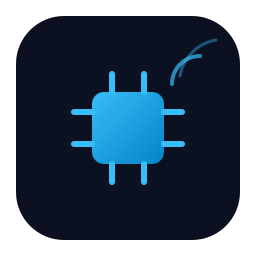

<p align="center">
  
</p>

<div align="center">

[](https://go.dev)
[](https://www.docker.com)
[](https://github.com/features/packages)
[](https://docusaurus.io)

</div>

# FogSense Device Runtime

<p align="center">
  <span><strong>One container</strong> = <strong>one simulated device</strong></span>
  &nbsp;•&nbsp;
  <span><strong>YAML-defined behavior</strong></span>
  &nbsp;•&nbsp;
  <span><strong>Gateway-ready runtime</strong></span>
</p>

One container = one simulated IoT device. The device is described entirely by a YAML device spec, so there is no per-device-type code inside the runtime.

## Overview

<div align="left">


</div>

This project is a small reference runtime for an IoT device simulator. Each device runs in its own container and exposes a standard HTTP API. The gateway/platform is responsible for discovery, registration, command delivery, and telemetry ingestion.

### Core idea

- one device = one container
- the device behavior is described by a YAML spec
- the runtime validates, executes, and reports state changes
- the gateway owns orchestration, while the device owns its own local state

## Quick start

### Pull the published image

```bash
docker pull ghcr.io/<your-org>/fogsense-device-runtime:latest
# or
# docker pull fogsense/fogsense-device-runtime:latest
```

### Run a device locally

```bash
docker build -t fogsense-device-runtime .

DEVICE_ID=light-1 \
GATEWAY_URL=http://127.0.0.1:8081 \
ADVERTISE_URL=http://127.0.0.1:8080 \
DEVICE_SPEC_FILE=examples/smart-light.yaml \
docker run --rm -p 8080:8080 fogsense-device-runtime
```

### Run the mock gateway and a device

```bash
go run ./cmd/mock-gateway --port 8081

DEVICE_ID=light-1 \
GATEWAY_URL=http://127.0.0.1:8081 \
ADVERTISE_URL=http://127.0.0.1:8080 \
DEVICE_SPEC_FILE=examples/smart-light.yaml \
go run .
```

## Package registry

The runtime is published as a container image to both registries:

- 
- 

Use the registry that matches your environment and access control model.

## Repository layout

| Path | Description |
| --- | --- |
| `main.go`, `pkg/` | The Go runtime implementation |
| `Dockerfile` | Multi-stage Docker build producing a minimal static container |
| `contract/device-spec.schema.yaml` | Schema for the device spec (structure + semantic rules in `description`) |
| `contract/device-api.openapi.yaml` | API exposed by each device (`/info`, `/state`, `/commands`, `/health`) |
| `contract/gateway-api.openapi.yaml` | API that your Fog Gateway must implement (`/devices/register`, `.../telemetry`, `.../events`) |
| `examples/*.yaml` | Sample specs (smart light, temperature sensor, thermostat, door lock) |
| `cmd/mock-gateway/` | Mock gateway for testing before you write your own |
| `docs/` | Docusaurus documentation website |

## At a glance

The project follows a simple pattern:

1. One container = one device.
2. The device owns its local state and executes commands.
3. Each device registers with a configured gateway and sends telemetry and status events to it.
4. The gateway acts as the coordination and aggregation layer and can send commands back to the device.

### Command flow

```text
Gateway / platform
        │
        │  calls device API: POST /commands
        ▼
Device runtime
        │
        │  validates + applies command effects
        ▼
State changes
        │
        └──> emits STATE_CHANGED event back to the gateway
```

This is why command requests are sent to the device's own HTTP endpoint, not to the gateway URL.

## Documentation

```bash
cd docs
npm install
npm start
```

## Quick test (without Docker)

Requires Go >= 1.22. You need three terminals; `go run` keeps running in the terminal where you start it.

### macOS / Linux

```bash
# terminal 1: mock gateway (prints a line when it is listening)
go run ./cmd/mock-gateway --port 8081

# terminal 2: simulated smart light
DEVICE_ID=light-1 \
GATEWAY_URL=http://127.0.0.1:8081 \
ADVERTISE_URL=http://127.0.0.1:8080 \
DEVICE_SPEC_FILE=examples/smart-light.yaml \
go run .

# terminal 3: send a command
curl -X POST http://localhost:8080/commands -H 'Content-Type: application/json' \
  -d '{"commandId":"c1","name":"SET_BRIGHTNESS","params":{"level":40}}'
```

### Windows (PowerShell)

```powershell
# terminal 1: mock gateway
go run ./cmd/mock-gateway --port 8081

# terminal 2: simulated smart light
$env:DEVICE_ID         = "light-1"
$env:GATEWAY_URL       = "http://127.0.0.1:8081"
$env:ADVERTISE_URL     = "http://127.0.0.1:8080"
$env:DEVICE_SPEC_FILE  = "examples/smart-light.yaml"
go run .

# terminal 3: send a command
Invoke-RestMethod -Method Post -Uri http://localhost:8080/commands `
  -ContentType "application/json" `
  -Body '{"commandId":"c1","name":"SET_BRIGHTNESS","params":{"level":40}}'
```

> In PowerShell, `curl` is an alias of `Invoke-WebRequest` and does not understand `-X`, `-H`, `-d`.
> Use `Invoke-RestMethod` as above, or call the real curl with `curl.exe`.

## Multiple devices

Each device exposes its own HTTP API on its configured `PORT` (default `8080`). If you start more than one device, send commands to the device's own URL, not the gateway URL.

```bash
# device 1
DEVICE_ID=light-1 \
GATEWAY_URL=http://127.0.0.1:8081 \
ADVERTISE_URL=http://127.0.0.1:8080 \
PORT=8080 \
DEVICE_SPEC_FILE=examples/smart-light.yaml \
go run .

# device 2
DEVICE_ID=light-2 \
GATEWAY_URL=http://127.0.0.1:8081 \
ADVERTISE_URL=http://127.0.0.1:8082 \
PORT=8082 \
DEVICE_SPEC_FILE=examples/smart-light.yaml \
go run .
```

```bash
curl -X POST http://localhost:8080/commands \
  -H 'Content-Type: application/json' \
  -d '{"commandId":"light-1-on","name":"TURN_ON"}'

curl -X POST http://localhost:8082/commands \
  -H 'Content-Type: application/json' \
  -d '{"commandId":"light-2-on","name":"TURN_ON"}'
```

If `DEVICE_TOKEN` is enabled, add `-H 'X-Device-Token: <token>'` to each request.

## Docker

### Bash

```bash
docker build -t fogsense-device-runtime .

docker run --rm --name light-1 --network <your-gateway-network> \
  -e DEVICE_ID=light-1 \
  -e GATEWAY_URL=http://fog-gateway:8081 \
  -e DEVICE_TOKEN=<device-token> \
  -e DEVICE_SPEC_B64="$(base64 -w0 examples/smart-light.yaml)" \
  fogsense-device-runtime
```

> On macOS, `base64` does not support `-w0`; use `base64 -i file | tr -d '\n'` instead.

### PowerShell

```powershell
docker build -t fogsense-device-runtime .

$spec = [Convert]::ToBase64String([IO.File]::ReadAllBytes("examples/smart-light.yaml"))

docker run --rm --name light-1 --network <your-gateway-network> `
  -e DEVICE_ID=light-1 `
  -e GATEWAY_URL=http://fog-gateway:8081 `
  -e DEVICE_TOKEN=<device-token> `
  -e DEVICE_SPEC_B64=$spec `
  fogsense-device-runtime
```

`<your-gateway-network>` is the Docker network your Fog Gateway container is attached to, and the name in `GATEWAY_URL` must be the gateway's service/container name on that network. When using the course-published image, `docker build` is not needed.

`docker-compose.example.yml` starts a mock gateway and two devices:

```bash
docker compose -f docker-compose.example.yml up --build
```

## Configuration

| Variable | Required | Description |
| --- | --- | --- |
| `DEVICE_ID` | yes | Unique id, `[A-Za-z0-9_.-]{1,64}` |
| `GATEWAY_URL` | yes | Base URL of the Fog Gateway, e.g. `http://fog-gateway:8081` |
| `DEVICE_SPEC_B64` / `DEVICE_SPEC` / `DEVICE_SPEC_FILE` | one of three | The spec: base64 YAML / YAML string / file path (default `/config/spec.yaml`) |
| `DEVICE_TOKEN` | no | Shared secret. The device sends it as `X-Device-Token` and requires it from anyone calling its API |
| `ADVERTISE_URL` | no | The URL the gateway uses to reach this device (default `http://<hostname>:<PORT>`) |
| `PORT` | no | Default `8080` |
| `REGISTER_INTERVAL_SEC` | no | Heartbeat registration period, default `30` |
| `TIME_SCALE` | no | Device time speed-up factor (for testing), default `1` |
| `SEED` | no | Integer for reproducible data generation |

If the spec is invalid, the container does not start: it prints all errors (with paths) as JSON lines and exits with code `2`.

## Device behavior

**Telemetry.** Each metric produces a value every `intervalSec` seconds: a random walk within `[min, max]` plus Gaussian noise (`noise`). With probability `anomalyRate`, the value goes out of range. If the metric has `follows`, it gradually moves toward the value of a numeric state field when the `when` conditions hold.

**State and commands.** A command validates its parameters, applies its effects, and returns the new state. Commands are idempotent by `commandId`. If the state changed, the device also sends a `STATE_CHANGED` event to the gateway.

**OFFLINE.** With probability `offlineRate` per second, the device goes offline for a few seconds. It first sends `STATUS_CHANGED(OFFLINE)` and then goes silent: no telemetry, no heartbeat, and commands are rejected with `503 DEVICE_OFFLINE`.

**Reliability toward the gateway.** Every message carries `(bootId, seq)` and is delivered at least once, in order. If the gateway does not respond, the device keeps up to 500 messages in memory and retries with backoff.

All durations are in device time unless `TIME_SCALE` is set.

## Spec limits

Up to 8 metrics, 8 state fields, 10 commands, 5 parameters per command, and 16 values per enum. Names must match `[A-Za-z][A-Za-z0-9_]{0,31}`. The remaining semantic rules are described in the `description` field of `contract/device-spec.schema.yaml`.

## Tests

```bash
go test -v ./...
```

**Contract conformance check.** The mock gateway can verify a running device against the contract (`--check`): health, info, state, commands, idempotency, error handling, tokens, and fault injection.

### Bash

```bash
# terminal 1
go run ./cmd/mock-gateway --port 8081 --device-token t --control-token c --check

# terminal 2
DEVICE_ID=d1 GATEWAY_URL=http://127.0.0.1:8081 DEVICE_TOKEN=t CONTROL_TOKEN=c \
  ADVERTISE_URL=http://127.0.0.1:8080 DEVICE_SPEC_FILE=examples/thermostat.yaml go run .
```

### PowerShell

```powershell
# terminal 1
go run ./cmd/mock-gateway --port 8081 --device-token t --control-token c --check

# terminal 2
$env:DEVICE_ID="d1"; $env:GATEWAY_URL="http://127.0.0.1:8081"; $env:DEVICE_TOKEN="t"
$env:CONTROL_TOKEN="c"; $env:ADVERTISE_URL="http://127.0.0.1:8080"
$env:DEVICE_SPEC_FILE="examples/thermostat.yaml"
go run .
```

## Troubleshooting

**`Unable to connect to the remote server` / `connection refused` on `localhost:8081`** means nothing is listening on that port.

1. `localhost:8081` is the mock gateway, not the device.
2. Check what listens on the port. Windows: `netstat -ano | findstr :8081`. macOS/Linux: `lsof -i :8081` or `ss -ltn | grep 8081`.
3. If you used Docker Compose: `docker compose -f docker-compose.example.yml ps` and `docker compose -f docker-compose.example.yml logs mock-gateway`.
4. Try `http://127.0.0.1:8081/...` instead of `localhost`.
5. The port might already be used by another program.
6. Inside a container, `127.0.0.1` is the container itself; use the gateway service name or `host.docker.internal` instead.

**The device starts but nothing reaches the gateway** — check that `GATEWAY_URL` is reachable from the device, both sides use the same `DEVICE_TOKEN`, and `ADVERTISE_URL` is reachable by the gateway.

**The container exits immediately** — the spec is invalid. Run `docker logs <container>`: every error is printed with its path, and the exit code is `2`.

## What it is not

It does not persist anything; each restart begins from the initial state. It is not safe for public exposure because the token is a shared secret sent over plain HTTP, and `cmd/mock-gateway` is not a reference implementation of the Fog Gateway.

## For maintainers

Publishing, GitHub Pages, CI, and Docker Hub instructions are in [`MAINTAINERS.md`](MAINTAINERS.md).

## License

UNLICENSED
