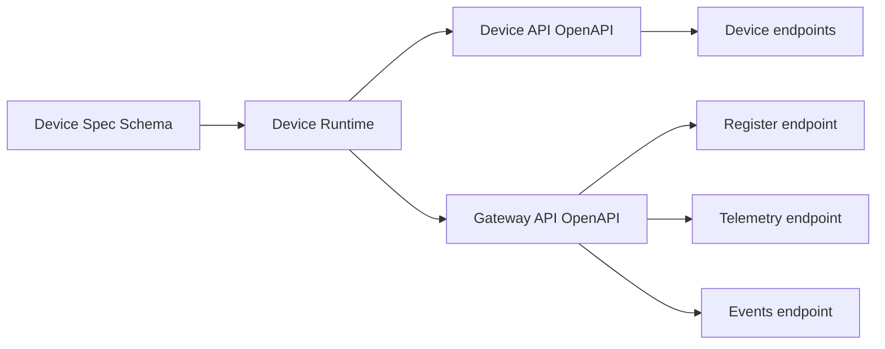

# Contracts & Schemas

FogSense uses a small set of canonical contracts to keep the runtime, gateway, and platform aligned. These files define the public interfaces and the shape of the device definitions.

## Canonical files

- [Device API OpenAPI](../../../contract/device-api.openapi.yaml) — the HTTP surface exposed by each device
- [Gateway API OpenAPI](../../../contract/gateway-api.openapi.yaml) — the endpoints your gateway must implement
- [Device Spec Schema](../../../contract/device-spec.schema.yaml) — the canonical YAML schema for device definitions

## Why this matters

The runtime does not guess how a device is shaped. It reads a device spec, validates it against the schema, and then exposes the behavior described by that spec.

The same is true for the gateway: the device runtime expects real gateway endpoints for registration, telemetry, and event delivery. Those contracts are the API boundary between the edge device and the platform.

## How to use them

1. Start with the device spec schema if you are creating a new device definition.
2. Use the device API contract when sending commands or reading state from a device.
3. Use the gateway API contract when implementing the gateway that receives device traffic.
4. Validate your changes against the same contract shape used by the runtime and mock gateway.

## Practical flow

When you implement a platform around the runtime, these files are the source of truth for what the system must accept and emit.
