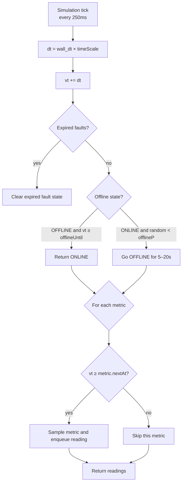

# Simulation Loop

The device runtime runs a continuous simulation loop that generates telemetry, handles offline periods, and manages device time.

## How the Loop Works

The simulation loop ticks every **250 milliseconds** (wall-clock time). Each tick:



## Device Time vs. Wall-Clock Time

All durations in the simulation (intervals, offline periods, fault durations) are expressed in **device time**:

```
device_time = wall_clock_time × TIME_SCALE
```

| `TIME_SCALE` | Effect |
|---|---|
| `1` (default) | Real-time simulation |
| `10` | Device runs 10× faster |
| `0.5` | Device runs at half speed |

This is controlled by the `TIME_SCALE` environment variable and is useful for testing:

```bash
TIME_SCALE=10 go run .  # 60s of device time passes in 6s of real time
```

:::info
`TIME_SCALE` must be between 0 (exclusive) and 1000 (inclusive).
:::

## Reproducibility

The simulation uses the **Mulberry32** pseudo-random number generator (PRNG). Setting the `SEED` environment variable produces deterministic, reproducible output:

```bash
SEED=42 go run .  # always generates the same sequence of values
```

When no seed is provided, a random seed is generated at startup.

## Internal State

The `Device` object maintains:

| Property | Description |
|---|---|
| `vt` | Virtual time (device-seconds since boot) |
| `status` | `"ONLINE"` or `"OFFLINE"` |
| `state` | Current state field values |
| `metrics` | Per-metric state (current value `x`, next emission time, last reading) |
| `recent` | LRU cache of recent command results (max 1,000 entries) |
| `bootId` | Random UUID generated at startup |
