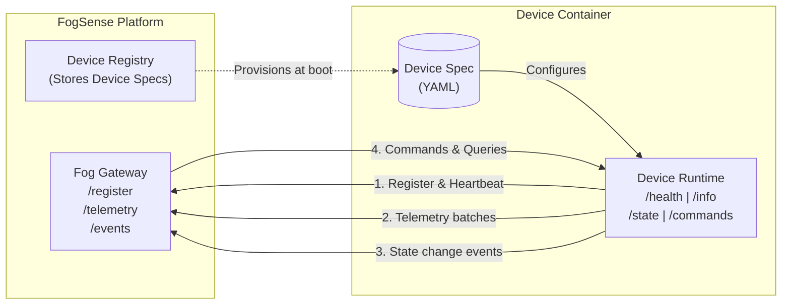

# FogSense Device Simulator

**One container = one simulated IoT device**, described entirely by a YAML device spec.

The FogSense Device Runtime is a generic IoT device simulator designed for the FogSense fog-computing platform. Instead of writing code for each device type, you describe the device's telemetry, state, and commands in a simple YAML file (the **device spec**) and the runtime handles everything else.

## Key Features

- 🔧 **Spec-driven**: No code changes needed per device type. A single YAML file defines the entire device behavior.
- 🚀 **High-efficiency Go engine**: Ultra-lightweight footprint (approximately 8-15 MB RAM per container) and compact Docker image (~15 MB). Run hundreds of devices on a single small VM.
- 📊 **Realistic telemetry**: Random walk simulation with configurable noise, anomaly rates, and state-following metrics.
- ⚡ **Stateful commands**: Idempotent command execution with parameter validation and state effects.
- 🌐 **Gateway integration**: Automatic registration, heartbeat, reliable at-least-once ordered delivery.
- 💥 **Fault simulation**: Random offline periods, instructor-injected faults (offline, spike, flood).
- 🐳 **Container-ready**: Each device runs in its own container, configured via environment variables.

## Architecture Overview



## How It Works

1. **Define** a device spec (YAML) that describes telemetry metrics, state fields, and commands.
2. **Start** the runtime container with the spec and a gateway URL.
3. The device **registers** with the gateway and begins sending **telemetry**.
4. The gateway (or other services) can send **commands** to change device state.
5. State changes trigger **events** pushed back to the gateway.

## Quick Start

```bash
# Start the mock gateway
go run ./cmd/mock-gateway --port 8081

# In another terminal, start a temperature sensor using Go:
DEVICE_ID=sensor-1 \
GATEWAY_URL=http://127.0.0.1:8081 \
ADVERTISE_URL=http://127.0.0.1:8080 \
DEVICE_SPEC_FILE=examples/temp-sensor.yaml \
go run .
```

See the [Getting Started](./getting-started.md) guide for a full walkthrough.
