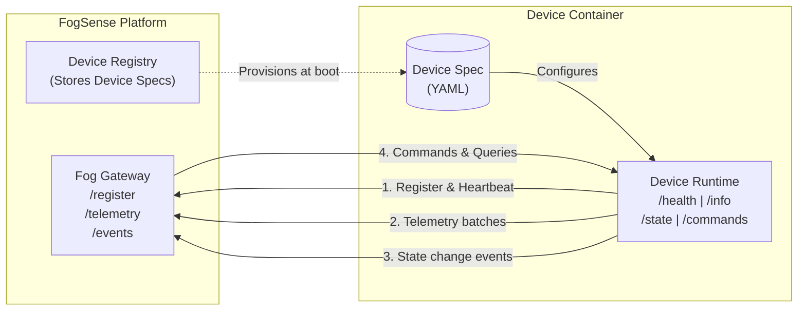

# FogSense Device Simulator

**One container = one simulated IoT device.**

FogSense Device Simulator lets you model a device purely as YAML: define telemetry, state, and commands once, then run the runtime and let it handle the rest.

## Why it exists

- **Spec-driven**: create a new device by editing YAML, not by writing Go code
- **Lightweight**: each device runs as a tiny, independent runtime process or container
- **Realistic behavior**: telemetry, offline periods, random faults, and state transitions are built in
- **Gateway-ready**: devices register with a gateway and emit telemetry/events as they run
- **Operationally simple**: the runtime exposes a standard device API for health, info, state, and commands

## Architecture Overview



## How it works

1. Define a device spec in YAML with telemetry, state, and commands.
2. Start the runtime with that spec and a gateway URL.
3. The device registers with the gateway and begins sending telemetry.
4. The gateway or another platform can send commands to change device state.
5. State changes trigger events back to the gateway.

## Communication model

FogSense uses two HTTP contracts:

- **Device API**: each device exposes a local HTTP API for `/health`, `/info`, `/state`, and `/commands`
- **Gateway API**: the gateway exposes the endpoints the device calls for registration, telemetry, and event delivery

The application contracts live in:
- [contract/device-api.openapi.yaml](../../contract/device-api.openapi.yaml)
- [contract/gateway-api.openapi.yaml](../../contract/gateway-api.openapi.yaml)

The runtime and the gateway both follow these contracts, so a platform can swap in a different gateway implementation without rewriting the device logic.

## Quick start

```bash
# Start the mock gateway
go run ./cmd/mock-gateway --port 8081

# In another terminal, start a temperature sensor using Go:
DEVICE_ID=sensor-1 \
GATEWAY_URL=http://127.0.0.1:8081 \
ADVERTISE_URL=http://127.0.0.1:8080 \
PORT=8080 \
DEVICE_SPEC_FILE=examples/temp-sensor.yaml \
go run .
```

Test a device command directly:

```bash
curl -X POST http://localhost:8080/commands \
  -H 'Content-Type: application/json' \
  -d '{"commandId":"demo-1","name":"TURN_ON"}'
```

See the [Getting Started](./getting-started.md) guide for a full walkthrough.
